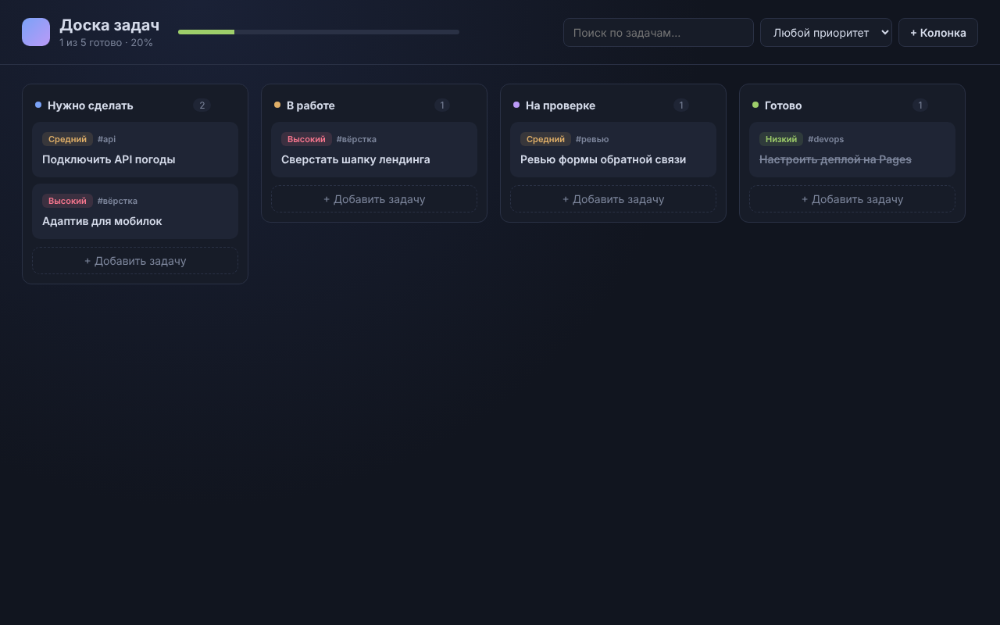
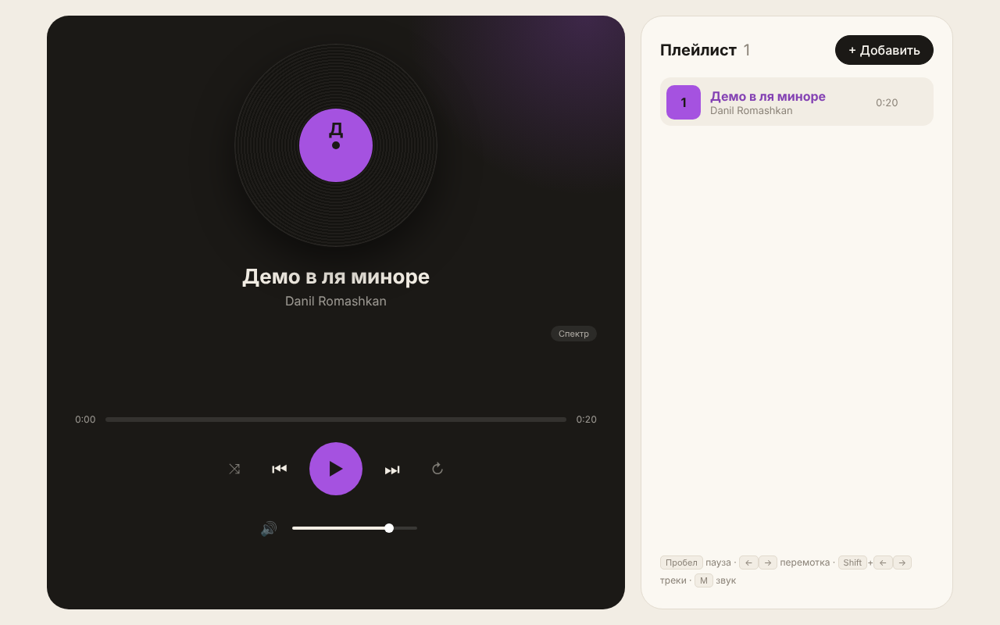

<p align="center">
  
</p>

<p align="center">
  <a href="https://t.me/np_ok"></a>
  <a href="mailto:danil.romashkan@yandex.ru"></a>
  <a href="https://t.me/CrimeaIT82"></a>
  
</p>

<p align="center">
  
</p>

---

### ⚓ Каюта капитана

```js
const danil = {
  role: 'Frontend-разработчик',
  base: 'Симферополь, Крым 🌊',
  experience: 'Web Castle · 2024–2026',
  education: 'КИПУ им. Февзи Якубова · прикладная информатика (магистратура, 2025–2027)',
  strongest: ['React', 'Vue 3', 'JavaScript'],
  backendWhenNeeded: ['Node.js', 'Python / FastAPI'],
  languages: { ru: 'родной', en: 'B2' },
  lookingFor: 'frontend — удалённо или с релокацией',
}
```

### 🧭 Навигационные приборы

<p>
  
</p>

### 🏝️ Острова — проекты

<table>
  <tr>
    <td width="33%" valign="top">
      <a href="https://github.com/danilromas/vue-kanban"></a>
      <h4>🗂️ <a href="https://github.com/danilromas/vue-kanban">Доска задач</a></h4>
      <sub>Канбан на Vue 3 + Pinia. Нативный drag &amp; drop, дедлайны, фильтры, localStorage.</sub><br/><br/>
      <a href="https://danilromas.github.io/vue-kanban/">Открыть демо →</a>
    </td>
    <td width="33%" valign="top">
      <a href="https://github.com/danilromas/vue-weather"></a>
      <h4>⛅ <a href="https://github.com/danilromas/vue-weather">Погода</a></h4>
      <sub>Прогноз по Open-Meteo. Свой SVG-график, поиск с debounce, геолокация, фон по погоде.</sub><br/><br/>
      <a href="https://danilromas.github.io/vue-weather/">Открыть демо →</a>
    </td>
    <td width="33%" valign="top">
      <a href="https://github.com/danilromas/vue-player"></a>
      <h4>💿 <a href="https://github.com/danilromas/vue-player">Плеер</a></h4>
      <sub>Web Audio визуализатор, винил, плейлист, Media Session, демо-трек синтезируется в браузере.</sub><br/><br/>
      <a href="https://danilromas.github.io/vue-player/">Открыть демо →</a>
    </td>
  </tr>
</table>

<p align="right"><a href="https://github.com/danilromas?tab=repositories">все репозитории →</a></p>

### 🏆 Судовой журнал

| Год | Где | Результат |
| :-: | --- | :-: |
| 2025 | Алгоритмическое программирование среди вузов Крыма | 🥇 1 место |
| 2025 | Алгоритмы, idman academy | 🥈 2 место |
| 2025 | Геймтон DatsTeam | 16 место |
| 2024 | ICPC, Санкт-Петербург | 150 из 400 команд |
| 2023 | Олимпиада 1С, Крым | 🥇 1 место |
| — | Хакатон среди всех вузов Крыма | 🥈 2 место |
| — | Алгоритмы, Грозный (все регионы России) | 7 место |
| — | Космокод, Краснодар | 52 из 150 |

### 🌊 Течение коммитов

<picture>
  <source media="(prefers-color-scheme: dark)" srcset="https://raw.githubusercontent.com/danilromas/danilromas/output/snake-sea.svg" />
  <source media="(prefers-color-scheme: light)" srcset="https://raw.githubusercontent.com/danilromas/danilromas/output/snake-sea-light.svg" />
  
</picture>

<p align="center">
  
</p>

<p align="center"><sub>44.95° N, 34.10° E · пишите в Telegram — отвечаю быстро</sub></p>
